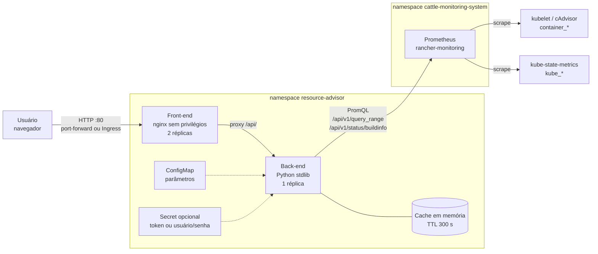
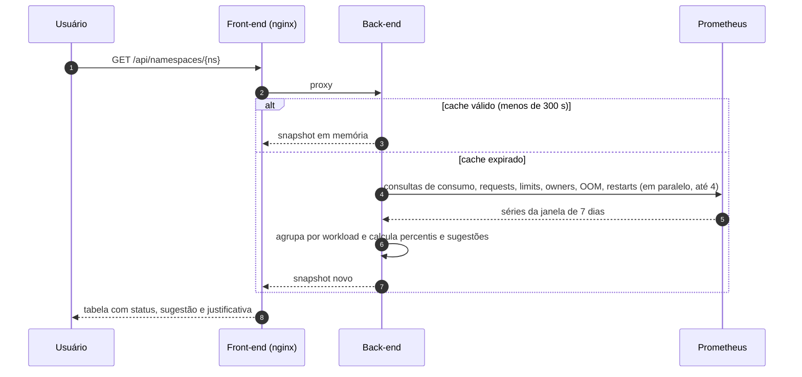
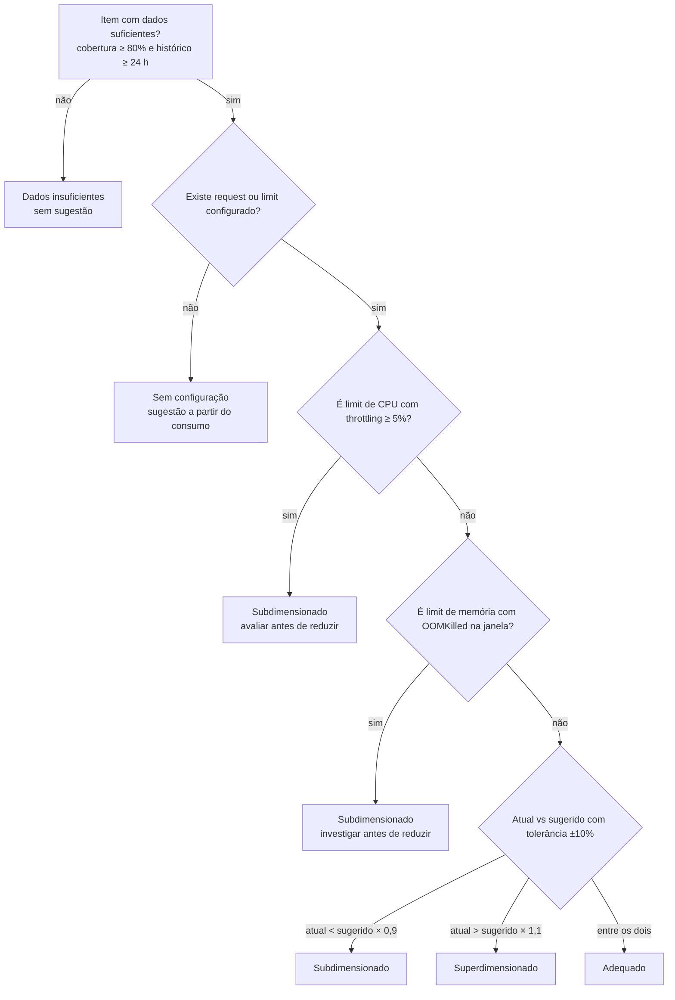

# Metodologia de recomendação de requests e limits

Este documento explica como o Resource Advisor compara o consumo real de cada container com os `requests` e `limits`
configurados, como calcula as sugestões e por que essas escolhas foram feitas.

Escrito para: engenheiros de plataforma e times de aplicação que vão usar, revisar ou ajustar as recomendações.

Arquitetura e fluxo de dados estão na seção [Arquitetura](#arquitetura). Os parâmetros configuráveis estão no
[README](../README.md#configuração-variáveis-de-ambiente-do-back-end).

---

## 1. Problema

No Kubernetes, o `request` é o que o scheduler reserva no nó para o pod. O `limit` é o teto de uso. Quando esses valores
são definidos "no chute", acontecem dois problemas:

- **Superdimensionamento:** o nó fica com capacidade reservada que não é usada. O custo sobe e a densidade cai.
- **Subdimensionamento:** o pod sofre throttling de CPU (fica mais lento) ou OOMKill (reinicia) quando a memória passa do limit.

O Resource Advisor responde: *dado o que o container realmente consumiu nos últimos dias, qual seria um valor razoável
para `request` e `limit`, e quão distante está a configuração atual?*

O app **não altera o cluster**. Ele gera uma sugestão e um trecho de YAML para revisão, que deve passar pelo fluxo de deploy
ou GitOps da equipe.

---

## 2. Escopo e premissas

| Premissa | Consequência |
|---|---|
| O histórico de consumo no Prometheus representa o comportamento futuro | Mudanças de carga, sazonalidade mensal ou lançamentos recentes não são previstos |
| A janela padrão é de 7 dias | Picos raros fora dessa janela não entram na análise |
| Cada container é tratado de forma independente | Dependências entre containers do mesmo pod não são consideradas |
| O cálculo é por workload (Deployment, StatefulSet, DaemonSet, Job) | Pods isolados sem controlador aparecem como `Pod` |

---

## 3. Arquitetura

O diagrama a seguir mostra os componentes e as conexões entre eles. A versão SVG está em
[arquitetura.svg](arquitetura.svg).



### Responsabilidades

| Componente | Responsabilidade |
|---|---|
| **Front-end** (`frontend/`) | Interface estática (HTML, CSS e JS sem build). O nginx serve os arquivos e encaminha `/api/` ao back-end. |
| **Back-end** (`backend/app/`) | Consulta o Prometheus, calcula as recomendações e expõe a API. |
| **Cache** (`service.py`) | Guarda o último snapshot por `CACHE_TTL_SECONDS`. Uma única análise por vez; as requisições simultâneas esperam o mesmo resultado. |
| **Prometheus** | Fonte única dos dados de consumo, requests e limits. O app não acessa o kubelet nem a API do Kubernetes diretamente. |

### Por que essa divisão

- **O app só lê dados.** Ele não precisa de permissão de escrita no cluster e não tem como alterar workloads.
- **O Prometheus já tem o histórico.** Reconstruir esse histórico a partir da API do Kubernetes exigiria armazenamento próprio.
- **Back-end em Python sem dependências externas.** Reduz a superfície de ataque e simplifica a imagem.
- **Cache local com uma réplica.** O cálculo é caro (vários percentis sobre 7 dias de séries). Com mais de uma réplica, cada uma calcularia separadamente.

---

## 4. Fluxo de uma análise



Se o Prometheus falhar:
- com um resultado anterior, a API responde com `meta.stale = true` e a interface mostra um aviso. Nova tentativa a cada 30 s;
- sem resultado anterior, a API responde 503.

---

## 5. Dados coletados e por quê

| Dado | Métrica | Para que serve |
|---|---|---|
| Consumo de CPU | `container_cpu_usage_seconds_total`, com `rate` de 5 min | Base do request de CPU e do limit de CPU |
| Consumo de memória | `container_memory_working_set_bytes`, máximo por passo | Base do request e do limit de memória |
| Throttling de CPU | `container_cpu_cfs_throttled_periods_total` ÷ `container_cpu_cfs_periods_total` | Indica que o limit de CPU está cortando o uso |
| Requests e limits atuais | `kube_pod_container_resource_requests` e `_limits` | Comparação com a sugestão |
| Pod → controlador | `kube_pod_owner`, `kube_replicaset_owner` | Agrupa pods no Deployment, mesmo depois da recriação |
| OOMKilled | `kube_pod_container_status_last_terminated_reason{reason="OOMKilled"}` | Indica que o limit de memória é insuficiente |
| Reinícios | `kube_pod_container_status_restarts_total` | Sinal complementar de instabilidade |

**Por que `working_set` e não `usage`:** o `working_set` é a memória que o kernel não consegue liberar facilmente. É o
valor que o kubelet usa para decidir OOMKill, então é o número relevante para o limit de memória.

**Por que `rate` de 5 min para CPU:** CPU é medida como contador acumulado. A taxa em janela curta mostra o consumo
instantâneo sem depender de reinícios do contador.

---

## 6. Cálculo das sugestões

### 6.1 Consumo de referência

Para cada pod, o app calcula o **P95** do consumo ao longo da janela. Depois, para o container do workload, usa o **maior
valor entre os pods**.

**Por que P95 e não média:** a média esconde picos. Um container que roda 95% do tempo em 100m e 5% em 1 core tem média
baixa, mas seu request de 50m causaria throttling constante nas horas de pico.

**Por que o maior entre os pods:** o workload é dimensionado para a réplica mais exigida. Se o mesmo request vale para todas
as réplicas, a média entre elas subdimensionaria a réplica mais pesada.

### 6.2 Request

```
request sugerido = max(piso, referência × (1 + margem_request))
```

| Parâmetro | Padrão | Motivo |
|---|---|---|
| Percentil | P95 | Cobre a maior parte do tempo sem reservar o pico absoluto |
| Margem | 20% | Folga para variações normais que não aparecem no histórico |
| Piso | 100m CPU, 32Mi memória | Boa prática do time: o boot das aplicações precisa de mais que 10m; nunca sugerir abaixo disso |

Exemplo do enunciado: request de 100m com referência de 200m e margem de 20% resultam em **240m** sugeridos, **+140m** de ajuste.

### 6.3 Limit

```
limit de CPU sugerido    = max(request sugerido, P99 × (1 + margem_limit))
limit de memória sugerido = max(request sugerido, máximo × (1 + margem_limit))
```

**Por que P99 para CPU e máximo para memória:** CPU é um recurso compressível. Se o limit for menor que o uso,
o processo fica mais lento (throttling) mas continua rodando. Memória não é compressível. Se o uso passar do limit, o
container é finalizado com OOMKill. Por isso o limit de memória cobre o pior caso observado na janela.

**Por que o limit nunca fica abaixo do request:** o Kubernetes rejeita configurações em que o limit é menor que o
request. O app já aplica essa regra na sugestão.

### 6.4 Agregação no workload

- **Requests e limits** são calculados por container. O workload soma a capacidade dos containers e das réplicas para
  mostrar o impacto total (`capacity.reclaim` e `capacity.add`).
- **Histórico:** o workload usa o menor histórico entre os containers. Assim, um container recente não fica escondido.

---

## 7. Classificação

Para cada item (CPU ou memória, request ou limit), o app compara o valor atual com o sugerido.



**Status do workload:** **Com desvio** se houver ao menos um item subdimensionado ou superdimensionado;
**Adequado** se todos os itens estiverem adequados; **Pendente** nos demais casos.

### Por que os overrides existem

- **Throttling de CPU ≥ 5%:** o cálculo pelo P99 pode sugerir um limit menor que o atual. Mas se o container já sofre
  throttling, reduzir o limit piora o problema. Por isso o app marca como subdimensionado e não recomenda reduzir.
- **OOMKilled:** o consumo observado pode ser truncado pela própria falta de memória. Antes de reduzir, é preciso
  investigar a causa.

### Por que a tolerância de ±10%

Pequenas diferenças entre o atual e o sugerido não justificam uma mudança de configuração, porque geram rollout
sem benefício. A faixa evita ruído.

### Por que os dados mínimos

- **Cobertura ≥ 80%:** a cobertura é a fração de passos da janela em que pelo menos um pod do container tem amostra.
  Lacunas grandes indicam que o histórico não representa o comportamento do container.
- **Histórico ≥ 24 h:** um dia inteiro captura ciclos de carga diários. Menos que isso pode ser só um pico isolado.

Quando os dados não atendem aos mínimos, o app não sugere valor. É melhor não recomendar do que recomendar com base em
pouca informação.

---

## 8. Comparação com outras abordagens

| Abordagem | O que faz | Diferença em relação ao Resource Advisor |
|---|---|---|
| **VPA (Vertical Pod Autoscaler)** | Ajusta requests automaticamente, com recomendações baseadas em histogramas de consumo | O VPA aplica as mudanças (ou pode só recomendar). O Resource Advisor só recomenda e não altera o cluster. |
| **Goldilocks** | Usa o VPA em modo recomendação e mostra os valores por workload | Mesma ideia de recomendação; o Resource Advisor calcula os percentis diretamente a partir do Prometheus |
| **Dashboards manuais** | Gráficos de consumo versus requests | Exigem análise manual por workload; o Resource Advisor automatiza o cálculo e a classificação |

**Por que não usar o VPA diretamente:** o VPA exige componentes no cluster e, em modo automático, reinicia pods para
aplicar mudanças. Para a política da equipe, a decisão deve passar por revisão e GitOps. O Resource Advisor fornece a
sugestão para essa revisão, sem interferir no cluster.

---

## 9. Limitações

- **Percentis sobre o passo da consulta.** A resolução do passo é de 15 min para janela de 7 dias e 30 min para 14 dias.
  Picos curtos de CPU podem ser suavizados. A memória usa máximo por passo, então os picos são preservados.
- **Sazonalidade.** Janelas de 7 ou 14 dias não capturam ciclos mensais, como fechamento contábil ou campanhas.
- **HPA.** O consumo por réplica depende do número de réplicas. Se o workload tem autoscaling, a sugestão vale para o
  número de réplicas observado.
- **OOMKilled é evidência, não contagem.** A métrica `last_terminated_reason` indica o motivo mais recente por passo.
  Não conta cada evento.
- **Resolução de controladores.** CronJob aparece como Job. ReplicaSet órfão cai para o nome do Deployment, removendo o
  sufixo de hash.
- **Validação ainda pendente.** Os testes usam um Prometheus simulado. A comparação com consultas diretas em dois
  namespaces reais (casos T01 e T07) precisa ser feita no ambiente.

---

## 10. Como validar uma recomendação

As consultas PromQL que reproduzem os cálculos estão em [docs/validacao-promql.md](validacao-promql.md). Use-as para
conferir os valores antes de aplicar uma mudança.

---

## Referências

- Kubernetes, gerenciamento de recursos de containers:
  https://kubernetes.io/docs/concepts/configuration/manage-resources-containers/
- cAdvisor, métricas expostas pelo kubelet
- kube-state-metrics, métricas de objetos do Kubernetes
- Vertical Pod Autoscaler (VPA), documentação do projeto kubernetes/autoscaler
